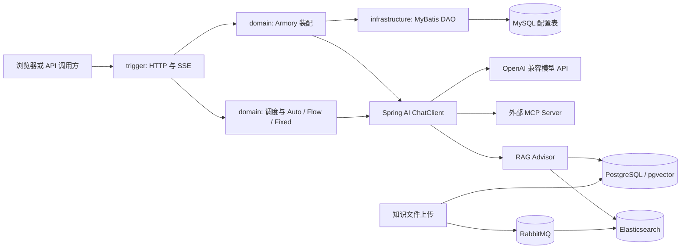

# HWAgentStation

基于 Java 17、Spring Boot 3 和 Spring AI 的可配置 AIOps Agent 工作站。项目从数据库装配模型、提示词、知识库和 MCP 工具，按任务选择执行策略，并通过 SSE 实时输出过程。整体采用 DDD 分层的单体架构。

项目以 AIOps 排障为主要应用方向：面对日志、监控和应用诊断等跨系统任务，可以把已有运维系统作为 MCP Server 接入，为不同 Agent 配置模型、提示词、工具与知识库，并选择合适的执行策略。**本仓库提供接入和编排能力；Prometheus、Arthas 等运维服务及其 MCP Server 需要使用者自行部署和配置。**不配置这些外部工具时，仍可运行普通问答或基于知识库的 Agent。

## 适用场景

- **运维排障**：Flow 先分析可用工具，再规划和逐步执行。接入日志、监控、诊断 MCP Server 后，可把多处信息组织成一个排查流程。
- **知识库问答**：把运行手册、故障处理记录等文档按知识标签入库；检索时结合向量和关键词召回。
- **固定业务链**：Fixed 按预设顺序调用多个 Client；Auto 则用分析、执行、质量监督循环处理需要迭代的任务。

这是可配置的 Agent 工程样例，实际排障结果取决于外部 MCP 服务、模型、提示词、知识数据及所选策略。

## 功能

| 能力 | 本版实现 |
| --- | --- |
| Agent 装配 | 从 MySQL 读取 Agent、Client、Model、Prompt、Advisor、MCP 配置，动态创建 ChatClient |
| 执行策略 | Auto 多轮分析/执行/监督、Flow 规划与逐步执行、Fixed 固定 Client 链 |
| 运行接口 | `/api/v1/agent/*`，执行接口通过 SSE 返回内容 |
| 知识增强 | PgVector 向量检索；可选查询改写、Elasticsearch BM25、BGE 精排 |
| 文档入库 | Tika 解析和切片，写入 PgVector，经 RabbitMQ 异步同步至 Elasticsearch |
| MCP | 按数据库配置接入 SSE、Streamable HTTP 或 stdio 工具 |
| 对话页 | `docs/dev-ops/nginx/html/index.html`，由 Compose 中的 Nginx 提供 |

`ChatMemory` Advisor 使用 Spring AI 的进程内消息窗口，重启后不保留会话记录。工程模块为 `api`、`app`、`domain`、`infrastructure`、`trigger`、`types`。

## 设计亮点

### 策略树编排与可见的执行阶段

`AgentDispatchService` 根据 `ai_agent.strategy` 选择执行策略，底层使用 `xfg-wrench` 策略树组织节点：

| 策略 | 过程 | 适合的任务 |
| --- | --- | --- |
| Auto | 任务分析 → 执行 → 质量监督；未达标时进入下一轮，最终总结 | 目标明确、需要多轮修正的任务 |
| Flow | 工具能力分析 → 任务规划 → 步骤解析 → 顺序执行 | 需要先选工具、再按步骤排障的任务 |
| Fixed | 按 `ai_agent_flow_config.sequence` 调用配置的 Client | 稳定、可预设的处理链 |

Auto 的分析和监督阶段可使用 `ai_agent_flow_config.step_prompt` 配置各角色提示词。Flow 的工具分析阶段明确要求把示例参数与真实业务参数区分开；执行阶段通过已装配 Client 的 MCP 回调调用工具。各阶段结果经 `ResponseBodyEmitter` 以 SSE 发给调用方，便于观察当前处理过程。过程事件未持久化，重启后无法回放。

### 数据驱动的 Agent 装配

模型 API、模型、Client、系统提示词、Advisor、MCP 工具及其关联分别存放在 MySQL 配置表中。Armory 按 API → MCP → Model → Advisor → Client 的节点链加载配置、构建 Spring AI 对象并注册运行时 Bean。这样可以为不同场景选择不同模型、知识库与工具组合。通过 `armory_agent` 接口按 Agent 装配；也可打开 `spring.ai.agent.auto-config.enabled`，在应用就绪后按 `client-ids` 预装配指定 Client，默认关闭。

启动预装配按配置的 Client 列表顺序运行；实际装配耗时取决于模型与 MCP 服务连接情况。

### MCP 接入与知识检索增强

`AiClientToolMcpNode` 按数据库中的 `transport_type` 装配 SSE、stdio 和 Streamable HTTP 三种 MCP Client，并将工具回调挂到 ChatClient。使用 Prometheus、Elasticsearch 或 Arthas 时，需先准备对应 MCP Server、连接参数、访问权限及匹配的系统提示词。

RAG 入库由 Tika 读取文档、切片并写入 PgVector，再经 RabbitMQ 同步至 Elasticsearch。查询时 `RagAnswerAdvanceAdvisor` 可按配置启用 Query Rewrite、向量检索、BM25 关键词召回、简化 RRF 融合及 BGE 精排，并通过 `knowledge` 标签限制检索范围；未配置的分支不会自动启用。

## 架构与数据流



| 模块 | 职责 |
| --- | --- |
| `api` | 接口契约、请求与响应 DTO |
| `trigger` | 用户端与管理端 HTTP 接口、RAG 同步消息监听 |
| `domain` | Agent 装配、策略树执行、RAG Advisor、文档处理 |
| `infrastructure` | MyBatis 持久化与消息发布 |
| `app` | Spring Boot 入口、数据源、线程池和运行配置 |
| `types` | 公共类型与异常 |

MySQL 保存配置，PgVector 和 Elasticsearch 保存可检索的文档数据。运行过程通过 SSE 传输，不提供历史运行回放。

## 启动条件

- Docker Engine + Compose v2；建议给 Docker 至少 6 GB 内存，供 Elasticsearch 和首次 Maven 构建使用。
- 支持聊天及 1536 维 embedding 的 OpenAI 兼容 API，以及有效的 `OPENAI_API_KEY`。
- MySQL 8 保存 Agent 配置；PostgreSQL + pgvector 保存向量；RabbitMQ 承载文档同步事件；Elasticsearch 保存关键词检索索引。这四项均在 Compose 中。
- 仅当 `RagAnswerAdvance` 配置选择 BGE 精排时，另行部署兼容 `POST /v1/rerank` 的服务，并在 `.env` 设置应用容器可访问的 `RERANK_BASE_URL`、`RERANK_API_KEY`。Compose 不捆绑模型权重或 GPU 服务。
- 仅当 Agent 配置引用外部 MCP Server 时才需要该服务。stdio 工具还依赖容器中存在其启动命令所需的程序。

### 配置项

| 变量或配置 | 用途 | Compose 默认/要求 |
| --- | --- | --- |
| `MYSQL_ROOT_PASSWORD`、`MYSQL_PASSWORD` | MySQL 初始化与应用连接 | 在 `.env` 中设置 |
| `POSTGRES_PASSWORD` | pgvector 数据库连接 | 在 `.env` 中设置 |
| `RABBITMQ_PASSWORD` | 消息队列连接和管理页登录 | 在 `.env` 中设置 |
| `OPENAI_BASE_URL`、`OPENAI_API_KEY` | 应用级 embedding 与可选查询改写 | 默认 OpenAI 地址；Key 必填 |
| `APP_PORT` | 宿主机应用 API 端口 | `8091` |
| `RERANK_BASE_URL`、`RERANK_API_KEY` | 选用 BGE 精排时连接模型服务 | 可选；地址须能从应用容器访问 |
| `spring.ai.agent.auto-config.enabled` | 启动时预装配指定 Client | 默认 `false` |
| `spring.ai.agent.auto-config.client-ids` | 预装配的 Client ID 列表 | 启用预装配时填入数据库中真实存在的 ID |

Compose 向应用注入 MySQL、PostgreSQL、RabbitMQ 和 Elasticsearch 的容器内地址。本机直接运行 Java 时则使用下文的宿主机端口。模型 API Key 可能同时存在于环境变量和 `ai_client_api` 配置表：前者供 embedding/查询改写使用，后者用于动态装配的具体模型。

## Docker 启动

在仓库根目录复制 `.env.example` 为 `.env`，修改全部密码，填入可用的模型 API Key：

```powershell
Copy-Item .env.example .env
docker compose up --build -d
docker compose ps
```

对话页：[http://localhost:8080](http://localhost:8080)；应用 API：[http://localhost:8091](http://localhost:8091)；RabbitMQ 管理页：[http://localhost:15672](http://localhost:15672)，用户名 `agent`，密码取自 `.env`。MySQL、PostgreSQL、AMQP、Elasticsearch 仅绑定本机，端口分别为 `13306`、`15432`、`15673`、`19200`。

```powershell
docker compose logs -f app
docker compose down
```

`down` 保留数据卷。MySQL 和 PostgreSQL 初始化脚本只在**首次创建空数据卷**时执行；已有数据卷需要手动检查和迁移，不应为重跑脚本删除现有数据。

Compose 启动的是基础服务和应用，**不会自动生成可对话的 Agent 或填入模型密钥**。初次打开对话页，Agent 列表为空是预期状态；需按下文创建配置并调用装配接口。应用与静态页面的端口仅供本机试用，外部访问需要另行设计鉴权和网络边界。

### 本机运行 Java

需要 JDK 17、Maven 3.9+。先启动依赖，再给本机进程设置连接参数：

```powershell
docker compose up -d mysql postgres rabbitmq elasticsearch
$env:MYSQL_URL = 'jdbc:mysql://localhost:13306/ai_agent_station?useUnicode=true&characterEncoding=utf8&serverTimezone=Asia/Shanghai&useSSL=false'
$env:MYSQL_USER = 'agent'
$env:MYSQL_PASSWORD = '<.env 中的 MYSQL_PASSWORD>'
$env:PGVECTOR_URL = 'jdbc:postgresql://localhost:15432/ai_rag_knowledge'
$env:POSTGRES_USER = 'agent'
$env:POSTGRES_PASSWORD = '<.env 中的 POSTGRES_PASSWORD>'
$env:RABBITMQ_HOST = 'localhost'
$env:RABBITMQ_PORT = '15673'
$env:RABBITMQ_USER = 'agent'
$env:RABBITMQ_PASSWORD = '<.env 中的 RABBITMQ_PASSWORD>'
$env:ES_BASE_URL = 'http://localhost:19200'
$env:OPENAI_API_KEY = '<有效的模型 API Key>'
mvn -DskipTests -pl HWAgentStation-app -am package
java -jar HWAgentStation-app/target/HWAgentStation-app.jar
```

`OPENAI_BASE_URL` 默认为 `https://api.openai.com`；使用其他兼容服务时也应设置它。表 `ai_client_api` 中的模型凭据独立于这些环境变量，需按 Agent 配置填写。

## 建表与配置 Agent

`deploy/mysql/init/01-agent-schema.sql` 根据 12 个 MyBatis Mapper 建立 Agent 配置表；`deploy/postgres/init/01-vector-store.sql` 创建 pgvector 扩展、`vector_store_test` 表及索引。

首次启动后数据库没有示例 Agent 或真实模型凭据。完成下面的配置才能发起对话：

1. 创建 `ai_client_api`（兼容服务地址和密钥）、`ai_client_model`、`ai_client`。
2. 在 `ai_client_config` 建立 Client → Model 关联，并按需加入 Prompt、Advisor、MCP。
3. 创建 `ai_agent`，将 `strategy` 设为 `autoAgentExecuteStrategy`、`flowAgentExecuteStrategy` 或 `fixedAgentExecuteStrategy`；在 `ai_agent_flow_config` 配置所用 Client 与顺序。
4. 调用 Agent 装配接口。配置改变后需重新装配。

Auto 所用角色代码包括 `TASK_ANALYZER_CLIENT`、`PRECISION_EXECUTOR_CLIENT`、`QUALITY_SUPERVISOR_CLIENT`；Flow 所用角色包括 `TOOL_MCP_CLIENT`、`PLANNING_CLIENT`、`EXECUTOR_CLIENT`。这些值必须与流程配置中的 `client_type` 匹配。Fixed 则按 `sequence` 顺序执行，不要求上述特定角色。

`/api/v1/agent/auto_agent` 是历史接口名称；控制器会读取目标 Agent 的 `strategy`，实际可分派到 Auto、Flow 或 Fixed。

```bash
curl -X POST http://localhost:8091/api/v1/agent/armory_agent \
  -H 'Content-Type: application/json' -d '{"agentId":"your-agent-id"}'
curl http://localhost:8091/api/v1/agent/query_available_agents
curl -N -X POST http://localhost:8091/api/v1/agent/auto_agent \
  -H 'Content-Type: application/json' \
  -d '{"aiAgentId":"your-agent-id","message":"你好","sessionId":"demo-1","maxStep":3}'
```

管理端接口位于 `/api/v1/admin/`，请求字段见 `HWAgentStation-api/src/main/java/com/flocier/api/dto`。知识文件上传路径是 `/api/v1/admin/ai-client-rag-order/file/upload`。Compose 会初始化 Elasticsearch 的 `rag_knowledge_v1` 索引。向量表固定为 1536 维；更换 embedding 维度时需同步调整建表定义。

## 构建与公开部署

```powershell
mvn -DskipTests package
```

首次构建需要 Maven Central 或阿里云 Maven 镜像中的 `xfg-wrench-starter-design-framework`。部分集成测试依赖外部模型、MCP 和搜索服务，因此日常打包默认跳过执行。管理接口没有鉴权；Compose 仅绑定本机端口，公网部署前必须补充身份认证、网络隔离和密钥管理。

生产使用还需关注：模型服务的接口与 embedding 维度须匹配；MCP stdio 命令与容器操作系统须匹配；BGE 服务需自行规划模型资源；数据库、队列和 Elasticsearch 数据卷应有备份；对外开放 SSE 时代理应关闭响应缓冲。当前 Nginx 配置已针对 SSE 关闭代理缓冲，但尚未经过真实生产流量验证。
